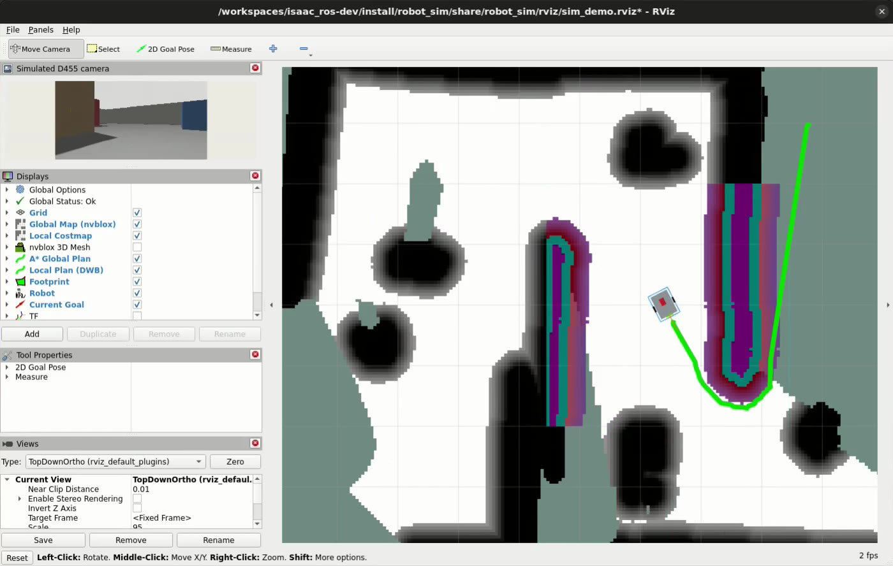
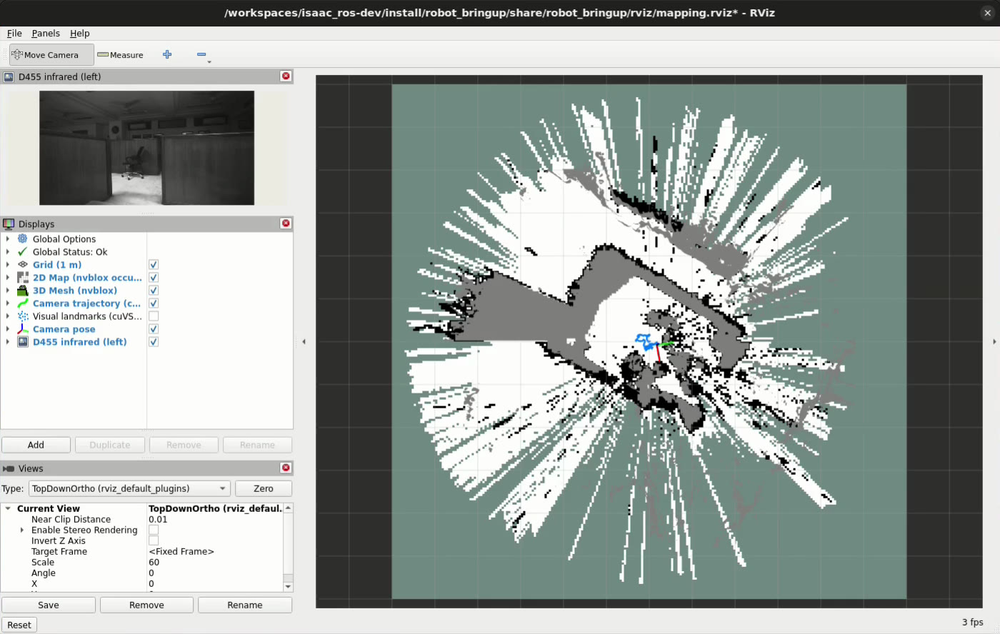

# Path Planning using SLAM on a Jetson Orin Nano (cuVSLAM + nvblox + Nav2 A*)

B.Tech Project, LNMIIT Jaipur. An autonomous mobile robot stack that **localizes with GPU stereo visual SLAM (cuVSLAM), builds a dense 3D/2D map on the GPU (nvblox), and plans with A\* (Nav2 NavFn)**, all on one NVIDIA Jetson Orin Nano with an Intel RealSense D455.

This repository covers the work up to:
- `scripts/run_real_mapping.sh`: real-time mapping of real rooms with the D455
- `scripts/run_gazebo_sim.sh`: full autonomous navigation demo in Gazebo (no hardware needed)

| Gazebo navigation (RViz) | Real lab mapped live with the D455 |
|---|---|
|  |  |

## Hardware and software
- NVIDIA Jetson Orin Nano (JetPack 6.2, CUDA 12.6), Intel RealSense D455
- ROS 2 Humble, Isaac ROS 3.2 in Docker (`isaac_ros_dev-aarch64-container`)
- cuVSLAM 3.2.6, nvblox 3.2.5, Nav2 (NavFn with `use_astar: true`, DWB controller), Gazebo Fortress (ros_gz)

## Architecture
```
 RealSense D455 ── stereo IR ──> cuVSLAM (GPU) ── pose / TF ──┐
        └──────── depth ───────> nvblox (GPU): TSDF -> ESDF ──┴─> Nav2 costmap -> A* (NavFn) -> DWB -> /cmd_vel
        (camera, cuVSLAM and nvblox run in ONE component container at nice -10)
 Simulation: Gazebo D455-like RGB-D camera + wheel odometry replace the real camera / cuVSLAM pose.
```

## Repository layout
```
src/robot_bringup/   real robot: mapping_launch.py, bringup_launch.py, perception.py, nav2_params.yaml, rviz/mapping.rviz
src/robot_sim/       simulation: URDF, demo_room.sdf world, sim_demo_launch.py, waypoint_demo tour node, RViz layout
scripts/             run_real_mapping.sh, run_gazebo_sim.sh, amr_container.sh (shared container helper)
results/sim_tour/    example output of a simulation run (report, CSV, final map)
docs/images/         screenshots
```

## Setup
1. Set up the Isaac ROS 3.2 dev container on the Jetson with the workspace at `~/workspaces/isaac_ros-dev`
   (mounted as `/workspaces/isaac_ros-dev`). Build `realsense-ros` from source in that workspace.
2. Copy (or symlink) the two packages into the workspace:
   ```bash
   git clone <this-repo> ~/amr_slam_nav
   ln -s ~/amr_slam_nav/src/robot_bringup ~/amr_slam_nav/src/robot_sim ~/workspaces/isaac_ros-dev/src/
   ```
3. The scripts install any missing apt packages in the container, build the packages with colcon,
   and start the container if needed (from a saved image `amr-isaac-ready:latest`, see `amr_container.sh`).

## 1. Real-world mapping with the D455
```bash
cd ~/amr_slam_nav/scripts
./run_real_mapping.sh                          # map saved as map_<date_time>
./run_real_mapping.sh labroom                  # map saved as "labroom"
./run_real_mapping.sh labroom cam_height:=0.8  # options: cam_height, emitter, imu, rviz
```
While running: `s` + Enter saves a snapshot, `q` + Enter (or Ctrl+C) saves the final map and stops.
Hold the camera level at about 1 m, keep it still for 3 s at the start, walk slowly and finish where you started.
Maps go to `~/workspaces/isaac_ros-dev/maps/<name>/` (`.pgm` + `.yaml` for Nav2, PNG preview, nvblox mesh `.ply`, cuVSLAM landmark map).
Needs about 2.5 GB free memory (the script waits for it).

Measured on the Jetson: cuVSLAM pose 29-30 Hz, depth integration 15 Hz, 2D map 4.9 Hz.

## 2. Gazebo simulation (autonomous navigation)
```bash
./run_gazebo_sim.sh                # RViz + automatic 5-goal tour
./run_gazebo_sim.sh rviz:=false    # headless (fastest, best results)
./run_gazebo_sim.sh tour:=false    # click "2D Goal Pose" in RViz yourself
./run_gazebo_sim.sh gz_gui:=true   # also open the Gazebo 3D window (heavy)
```
The robot starts with an empty map in a 10 x 8 m room with partitions. A test node runs 12 pre-flight checks,
drives a 5-goal tour and saves `test_report.txt`, `results.csv` and the final map to `~/workspaces/isaac_ros-dev/demo_results/`.
Needs about 3.5 GB free memory.

Reference headless run: **5/5 goals, 61.9 m in 169 s, every A\* plan under 0.1 s (mean 60 ms)**.
`results/sim_tour/` holds a later run with RViz open (4/5 goals); CPU load from RViz or screen recording visibly hurts results on the Orin Nano.

## Lessons / gotchas
- nvblox 3.2 workspace-bound parameters need the `static_mapper.` prefix; without it they are silently ignored and nvblox runs out of CUDA memory.
- The D455 firmware re-enables the IR projector after streaming starts; the launch file switches it off again after 10 s.
- cuVSLAM IMU fusion can diverge when frames are dropped, so mapping defaults to visual-only (`imu:=false`).
- The container shares the host PID namespace: the scripts only stop processes whose cgroup belongs to the container. Never use `pkill -f` from inside it.
- The Orin Nano has no hardware video encoder; avoid on-device screen recording while the stack runs.

## Author
Vijay Kumar Saini (23UME555), supervised by Dr. Mohit Makkar, Department of Mechanical-Mechatronics Engineering, LNMIIT Jaipur.
